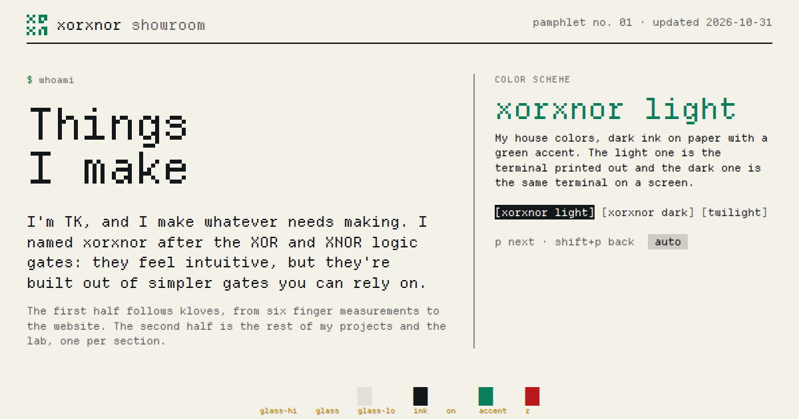

  

<h1>showroom</h1>

  xorxnor's pamphlet no. 01 · <a href="https://t0kies.github.io/showroom/">t0kies.github.io/showroom</a>

 

I'm TK, and I make whatever needs making. I named xorxnor after the XOR and XNOR
logic gates: they feel intuitive, but they're built out of simpler gates you
can rely on.

This is pamphlet no. 01, one page about what I've been building. Every piece on
it runs on its own project's code (a kloves run drawn by luna, a round of Odd
One Out, stools' stream controls, grunts' punch panel, a typing test and more),
and it's plain HTML and ES modules, so GitHub Pages serves it as is.

  

 

## Contents

- [What's on it](#whats-on-it)
- [How it's put together](#how-its-put-together)
- [Keys](#keys)
- [Real and made up](#real-and-made-up)
- [Layout](#layout)
- [Credits](#credits)

 

## What's on it

Part one (01 to 08) follows one keyboard, kloves, from six finger measurements
to the website, with ooo, stools and xorxnor along the way. I put the text-cell
version of each TUI component (ooo, luna) next to the WebTUI one (xorxnor,
stools), so it goes through forms, file lists, a 3D model, code, an SVG and a
PDF, a game you can play, stream controls and project cards.

Part two (09 to 16) is the rest of the bench, one project or lab piece per
section:

| # | piece | from |
|---|---|---|
| 09 | kiosk frames, progress bar, shell log marks | offload-bay `lib/ui.sh` `symbols.sh`, xoxn `sh/lib.sh` |
| 10 | live warehouse grid, cat banners | litterbox `view/web/index.html`, xoxn `marks/dist/txt` |
| 11 | a knurling pattern growing, boxed in, made sharp and traced to SVG | maze-patterns `rd/` |
| 12 | 1-bit pixel splash, CRT glitch text | splash-screen, xorxnor `CrtText.tsx` `crt.css` |
| 13 | terminal screens, fire splash, block digits | bufftime `scripts/` |
| 14 | PUNCH / AIM / HEART tabs and the OLED | grunts `tools/demo/internal/panel`, `firmware/src` |
| 15 | typing test | typing-speed, ported from C++ |
| 16 | alert box, toast, ask/confirm dialog | stools `js/overlay/alert-box.js`, `js/lib/` |

17 is headlines: edble and its menu PDFs, xorxnor and its one-page resume PDF,
app-template's CRT phone controls, the kloves services I named after my cats,
ooo's captured screens, stools' effects and the kit's color schemes.

 

## How it's put together

The page imports each project's real modules: ooo's `oddOf()` and board run the
round, luna's text cells, 3D view and PDF viewer draw the run, and bufftime
paints its own screens. They sit in `vendor/` as they are, with three changes
so they work on one page (stools' `/css/` paths made relative, luna's
`signal` scheme keyed on `data-skin`, and ooo's and luna's styles wrapped in
`@scope` so they leave the WebTUI side alone).

The cards in 08 show kloves' `Hash()` and grunts' `classify()`, cut out of the
Go and C++ by the build and highlighted by luna. grunts' terminal themes come
straight out of its Go palette too. In 14 the panel and the OLED both read one
hit count (`hits.js`), where a hit is either a punch or a move.

Everything sits on a 12-column grid that holds from 360px up, and `fit.js` sizes
each fixed-width screen to the biggest crisp font that fits. The color schemes
come from the kit's skins plus luna's signal, and every piece listens to the
same one, so `p` repaints both sides at once.

The logic that doesn't need a page (the round's rules, the hit count, typing
scores, the knurling run's cleanup and tracing, and the build's cutters) runs
under `node --test`.

 

## Keys

| key | does |
|---|---|
| `p` / `shift+p` | next / previous color scheme |
| `auto` button | a new scheme every 4 seconds |
| `#vfd` in the URL | opens that scheme |
| `1 2 3` or `q w e` | pick a swatch in the game, `space` to play again |

## Real and made up

The kloves run `abfe417d373dbe87` is real: the six numbers, the file names,
sizes and timestamp, and the files themselves. So are the game's code and
rules (35 seconds, five hearts, the shade difference going from 16 down to 3),
the code on the cards, the ooo screens and every component's CSS and
JavaScript.

The cats' scores in the game are made up, and so is the demo data in 09 to 16
(the card in offload bay, litterbox's stock, bufftime's sets, the grunts
punches and heart rate, and the raids). Each one says so on the page.

 

## Layout

| path | what |
|---|---|
| `index.html` | the whole pamphlet |
| `src/main.js` | loads every section in page order |
| `src/schemes/` | switching schemes (p, auto, the URL), the cover's panel, swatches |
| `src/part-one/` | the run drawn by luna, the Odd One Out round, the working controls, 08's cards |
| `src/part-two/` | one folder per section, 09 to 16 |
| `src/headlines/` | 17: the phone controls and the scheme chips |
| `src/lib/` | what every section uses: `$`, colors read off the screen, `fit.js` |
| `styles/` | the 12-column grid, the cover, the story, part two's sections |
| `vendor/` `samples/` `skins.js` | the projects' own code and files, copied in |

 

## Credits

Everything is set in [Departure Mono](https://departuremono.com) by Helena
Zhang, under the SIL Open Font License 1.1 (the license sits next to the font
in `vendor/fonts/`). The twilight scheme is my take on Twilight from
[dexpota/kitty-themes](https://github.com/dexpota/kitty-themes).
